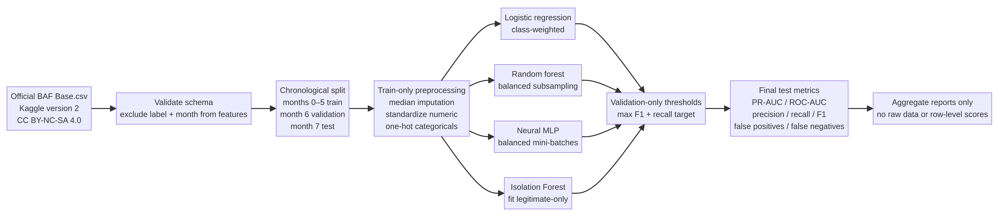
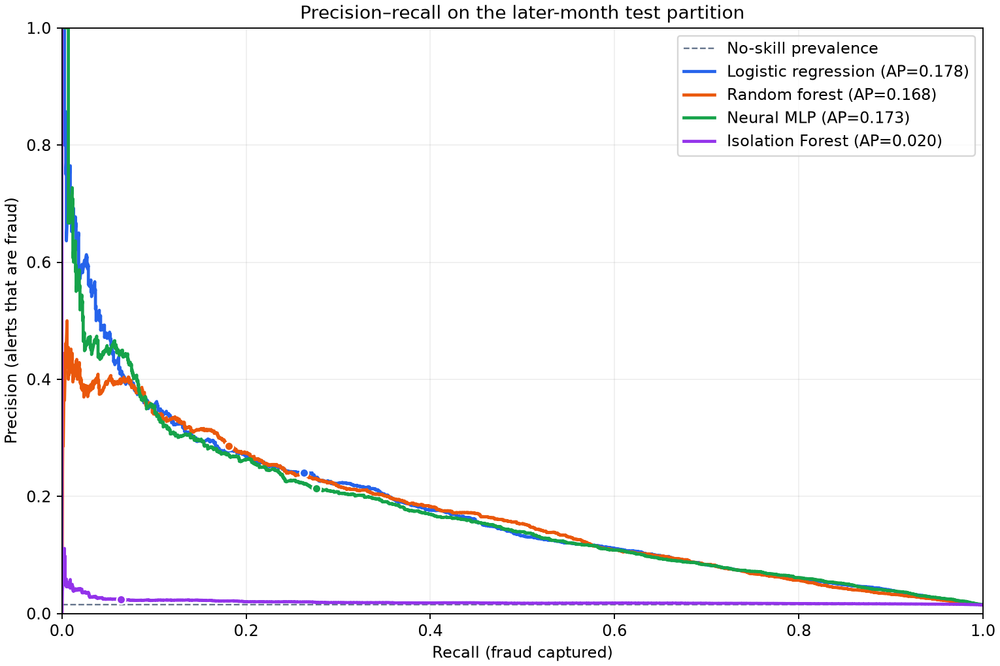

# Fraud Detection AI

An imbalance-aware fraud and anomaly detection benchmark using Feedzai's synthetic Bank Account Fraud (BAF) **Base** dataset. It compares class-weighted logistic regression, a balanced random forest, a neural MLP trained with balanced mini-batches, and a legitimate-only Isolation Forest. The pipeline uses chronological partitions and selects alert thresholds on validation data only.



> **Research and education only.** BAF is synthetic and privacy-preserving, not raw bank data. The results below describe one later-month synthetic test split; they do not establish live fraud-prevention performance.

## Results: rare events make threshold choice consequential

The one-million-row Base dataset contains eight ordered months. Fraud prevalence rises from about **0.99% in the sampled earlier-month training data** to **1.34% in validation** and **1.47% in the latest-month test set**. The experiment trains on a deterministic 250,000-row sample from the 794,989-row earlier-month pool, selects thresholds using all 108,168 validation rows, then evaluates on all 96,843 test rows (1,428 frauds). The test split was not used for tuning.

At each model's validation-selected maximum-F1 threshold, results on the test month were:

| Model | Average precision (PR-AUC) | ROC-AUC | Precision | Recall | F1 | False positives | False negatives |
|---|---:|---:|---:|---:|---:|---:|---:|
| Logistic regression | **0.1783** | 0.8816 | 0.2408 | 0.2626 | **0.2513** | 1,182 | 1,053 |
| Neural MLP | 0.1734 | **0.8825** | 0.2138 | **0.2759** | 0.2409 | 1,449 | 1,034 |
| Random forest | 0.1681 | 0.8719 | **0.2862** | 0.1814 | 0.2220 | **646** | 1,169 |
| Isolation Forest | 0.0196 | 0.5778 | 0.0237 | 0.0637 | 0.0345 | 3,750 | 1,337 |

There is no one winner at every operating point: the random forest made fewer false-positive alerts but missed more than four in five frauds at its F1 threshold; logistic regression had the best average precision and F1; the MLP reached slightly higher recall and ROC-AUC. Isolation Forest performed poorly on this benchmark, showing that unusual-looking records alone did not reliably correspond to the fraud labels.

A second policy selected each model's threshold on validation to target at least 80% recall. On test, measured recall ranged from **77.5% to 90.4%**, with precision only **1.64%–6.65%**. That meant between **15,538 and 77,240 false-positive alerts** among legitimate applications, depending on the model. The logistic threshold fell below its validation recall target on test, consistent with the changing prevalence and broader month-to-month distribution shift. This is why a threshold target is not a guarantee and why false-positive workload must be considered alongside recall.



Average precision (stepwise PR-AUC) is more informative than accuracy under extreme class imbalance. The PR chart includes the test prevalence as a no-skill reference and marks each model's validation-F1 operating point after applying it to test. The complete metrics are in [`reports/metrics.csv`](reports/metrics.csv), the split/protocol and dataset checksum are in [`reports/evaluation_summary.json`](reports/evaluation_summary.json), and a readable discussion is in [`reports/error_analysis.md`](reports/error_analysis.md).

## Data, license, and provenance

The benchmark uses only **Base.csv** from [Feedzai's BAF dataset suite on Kaggle](https://www.kaggle.com/datasets/sgpjesus/bank-account-fraud-dataset-neurips-2022), pinned to dataset version 2. Feedzai describes BAF as synthetic, privacy-preserving data generated from an anonymized real-world bank-account-opening fraud dataset. The [NeurIPS 2022 paper](https://proceedings.neurips.cc/paper_files/paper/2022/hash/d9696563856bd350e4e7ac5e5812f23c-Abstract-Datasets_and_Benchmarks.html) discusses temporal dynamics, severe imbalance, and controlled bias. The Kaggle data card lists **CC BY-NC-SA 4.0**; users must review its terms before downloading or reusing the data. The raw data remain local and are ignored by Git; no raw dataset, fitted weights, or individual-level prediction output is distributed. The project's original code is MIT-licensed, which does not relicense the dataset. See [`DATA_SOURCES.md`](DATA_SOURCES.md) and [`LICENSE`](LICENSE).

The reports record the source version, dataset SHA-256, chronological months, sample sizes, fraud counts, and thresholds. The downloaded CSV's SHA-256 for this run is `7bf10a37ce07e72e14c1b09e5efee3d27261baff4facc7da767b0474dcf9b809`.

## Evaluation design

Months 0–5 form the earlier training pool, month 6 is validation, and month 7 is held out for test. The training cap selects 250,000 rows deterministically from the earlier months without balancing classes; validation and test keep the complete natural distributions. `month` is used only for splitting and never given to the models. Numeric imputation/scaling and categorical imputation/one-hot encoding are fit on training data only.

The model families demonstrate different responses to imbalance. Logistic regression uses `class_weight="balanced"`; random forest uses `class_weight="balanced_subsample"`; the MLP trains on 1:3 fraud-to-legitimate mini-batches while thresholds are calibrated on naturally imbalanced validation data; Isolation Forest is fit only on labeled legitimate training examples. The last approach is a one-class baseline that has known-normal labels, not a fully unsupervised comparison. Each approach reports both validation-max-F1 and validation-recall-targeted thresholds, and test metrics include precision, recall, F1, average precision, ROC-AUC, false-positive rate, confusion counts, and alert volume.

## Run it

Python 3.10+ is required. With [uv](https://docs.astral.sh/uv/):

```bash
uv sync --extra test
uv run pytest
uv run ruff check .
uv run fraud-lab download
uv run fraud-lab run
```

`download` fetches the version-pinned Base variant through Kaggle's public dataset API and prints its SHA-256. For a custom local CSV use `uv run fraud-lab run --data /path/to/Base.csv`. Set `--max-train-rows 0` to train on the full earlier-month pool instead of the default 250,000-row resource-bounded sample. The CLI writes aggregate reports under `reports/` and does not save row-level predictions.

## Limitations and responsible use

These metrics are synthetic and specific to a single later month in one generated suite. They cannot show how a detector generalizes to an actual bank, country, product, applicant population, or emerging fraud pattern. No confidence intervals, calibration guarantees, human-review capacity, or monetary cost matrix are supplied. A deployment threshold should reflect an explicit review budget and customer-harm trade-off; the reported validation policy is an illustration, not a recommendation.

BAF includes features with demographic or protected-attribute relevance and is intended to support bias evaluation, but this project has not performed a fairness audit. It is not a production service, a financial recommendation, or evidence of real-world fraud reduction. Public GitHub publishing remains pending approved `bereket-web` access; nothing has been published under the connected `bereket74` account. No Hugging Face model, dataset, or Space has been published.

## References

- Jesus et al., [“Turning the Tables: Biased, Imbalanced, Dynamic Tabular Datasets for ML Evaluation,” NeurIPS 2022](https://proceedings.neurips.cc/paper_files/paper/2022/hash/d9696563856bd350e4e7ac5e5812f23c-Abstract-Datasets_and_Benchmarks.html).
- [Official Feedzai BAF repository](https://github.com/feedzai/bank-account-fraud) and [dataset datasheet](https://github.com/feedzai/bank-account-fraud/blob/main/documents/datasheet.pdf).
- [Kaggle BAF data card and CC BY-NC-SA 4.0 license](https://www.kaggle.com/datasets/sgpjesus/bank-account-fraud-dataset-neurips-2022).
